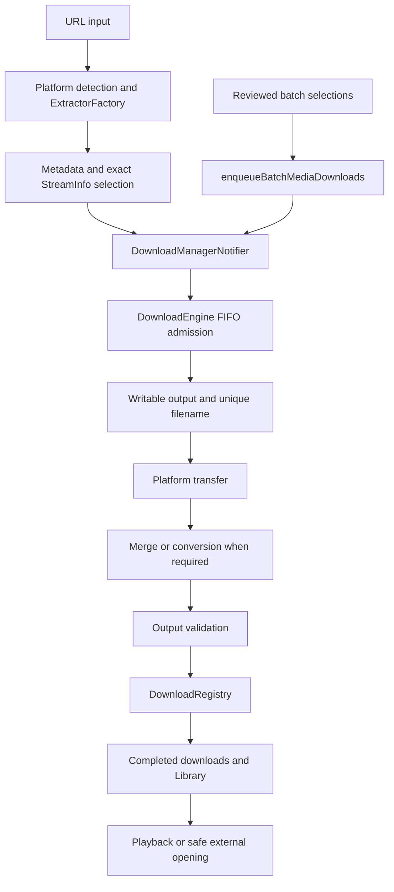

# MediaGrab architecture

This document describes the existing application boundaries. Read [AGENTS.md](AGENTS.md) for detailed compatibility rules and [the documentation index](docs/README.md) for task-specific references. The [known limitations](docs/known-limitations.md) explain safeguard rationale and unresolved risks; this overview does not establish new test results.

## Application structure

MediaGrab uses Flutter, manual Riverpod providers, and feature directories with domain, data, and presentation layers where applicable. Production persistence uses JSON and SharedPreferences. Declared database and incoming-share plugins do not imply an implemented database or incoming-share Dart workflow.

| Area | Responsibility |
| --- | --- |
| `lib/main.dart`, `lib/app.dart` | Initialize notifications and providers, configure themes/router, and checkpoint initialized subsystems on background transitions. |
| `lib/shared/widgets/app_startup.dart` | Render the destination immediately, schedule first-frame work, and observe lifecycle changes. Android resources own the launch splash. |
| `lib/features/home/` | URL input, clipboard handling, recent media, and entry into extraction. |
| `lib/features/extractor/` | Source adapters, metadata and stream entities, quality selection, and batch preparation. |
| `lib/features/downloads/` | Settings/connectivity policy, FIFO execution, transport, media processing, output validation, and persistence. |
| `lib/features/library/` | Search/filter/sort projections of registered completed media. |
| `lib/features/player/` | In-app video playback, lifecycle pause, and controller cleanup. |
| `lib/features/settings/` | Persisted preferences and appearance controls. |
| `lib/core/` | Themes, brand artwork, file/URL/storage utilities, and download notifications. |
| `lib/routing/`, `lib/shared/` | Routes, navigation shell, and reusable widgets. |

## Download data flow

The manager owns cellular checks, configured directories, and concurrency preferences. The engine owns admission, execution, cancellation, and completion. UI code owns navigation. Every playlist or multi-URL enqueue uses the shared helper so directory resolution, filename sanitization, and companion audio remain consistent.

## Extraction and source extensions

`ExtractorFactory` owns registered `BaseExtractor` adapters and closes them according to the existing client ownership contracts. Manual FutureProvider families expose metadata, streams, and playlists.

YouTube extraction preserves the primary metadata request, official oEmbed fallback, default manifest attempt, legacy client fallbacks, and maintained VisionOS recovery. Native stream recovery remains available, but does not guarantee recovery from every attestation or access restriction. Exact itag, codec, dimensions, frame rate, and companion-audio selection must survive recovery.

Facebook and Instagram adapters parse source HTML/JSON and shared social stream representations. New adapters return real muxed, video-only, or audio-only `StreamInfo` entries and use the existing manager, engine, and shared merger. See [platform contribution guidance](CONTRIBUTING.md#adding-support-for-another-platform).

## Queue, cancellation, and restart behavior

Tasks move through queued, downloading, merging/converting, and completed or failed states. Pause releases execution; explicit Resume admits paused work. Retry reuses a failed or cancelled task ID. Runtime concurrency reductions let already-active work finish.

YouTube runs use cancellation tokens and acknowledged writer completion before resume/retry. Generic merge pause/cancel also joins its FFmpeg writer. Failed or paused processing preserves source tracks; successful completion removes them after validation. Generic network and native callback handling still have documented lifecycle risks; see the [known limitations](docs/known-limitations.md).

| Store | Purpose and compatibility boundary |
| --- | --- |
| `mediagrab_download_registry_v1` and `mediagrab_registry.json` | Authoritative completed-media records and documents backup. Existing IDs and fields remain compatible. |
| `mediagrab_download_session_v1` | Selected streams, task state, paths, byte counts, companion audio, and native-task checkpoints. |
| `batch_draft_v2` | Batch selections, overrides, inclusion flags, and linked task state. |

Restoration hydrates completed registry records, reconnects native jobs, and restores interrupted in-process/queued work paused for explicit Resume. Batch edits debounce and flush on disposal/background transitions. SharedPreferences and lifecycle callbacks cannot guarantee persistence before sudden process death.

## Media processing and validation

The engine uses `MediaMerger` across platforms. `YoutubeMergePlan` keeps its compatible API by delegating to the shared policy. Muxed streams skip merging.

- MP4 can copy compatible AAC only when probing verifies start differences within 50 ms and duration differences within 250 ms. Missing or invalid timing uses audio resampling.
- WebM uses compatible copy/Opus rather than AAC.
- Processing preserves `-avoid_negative_ts make_zero -shortest`; encoding/repair keeps `aresample=async=1`. Audio filtering is not combined with audio stream copy.
- YouTube keeps video stream copy and strict validation of selected dimensions, frame rate, required tracks, known codecs, duration, and packet-read integrity. A 416 response alone never proves a complete YouTube transfer.
- Generic completion still has weaker legacy validation and transport rules. Do not treat these as equivalent guarantees or copy them into new transport code.

## Storage and presentation

The library reads registered completed media and verifies files without scanning shared storage or silently removing registry history. File deletion must succeed before history is removed.

Output selection physically probes writability and falls back to app documents/MediaGrab when needed. A fallback must reserve a unique name against both files and tasks. External opening uses `openMediaFile` and Android FileProvider; titles use sanitized display names.

The indexed navigation shell contains `/home`, `/downloads`, `/library`, and `/settings`. Details, batch preparation, and player routes sit outside it. New downloads select `/downloads?tab=active`; recent completed-media navigation selects `/downloads?tab=completed`. Completed videos use the in-app player with URI-encoded file path and title.

Ordinary widgets use semantic theme colors. System/light/dark, wallpaper colors, and true-black AMOLED remain supported. Native Android resources own the single launch splash; `HeroBackground` and `HeroWavePalette` own the current Flutter brand artwork.

## Android background execution

`DownloadNotificationService` serializes actual notification-plugin foreground-service starts/stops while tasks change. The `mediagrab_downloads` channel, notification-plugin service, WorkManager `SystemForegroundService` dataSync declaration, and foreground-service permissions are all required.

A notification alone does not promote the process. Background-start restrictions, dataSync time budgets, force-stop, and OEM process termination still apply. Plugin 18.0.1 lacks a timeout override; Dart/FFmpeg work has no guaranteed process-death continuation.

Compile SDK is configured as 37. The maintenance build recorded minSdk 24 and targetSdk 36 from the merged manifest; recheck generated manifests after toolchain changes rather than assuming old values. Release currently uses debug signing. Exact toolchain versions, commands, and unresolved risks are maintained in [AGENTS.md](AGENTS.md).
